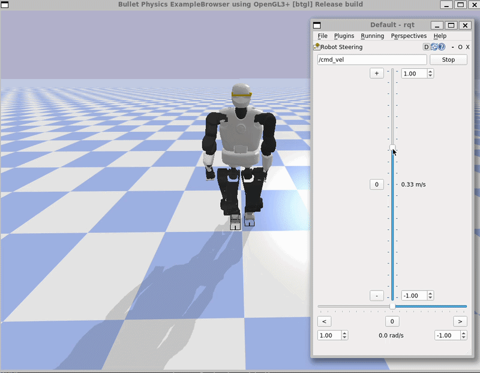
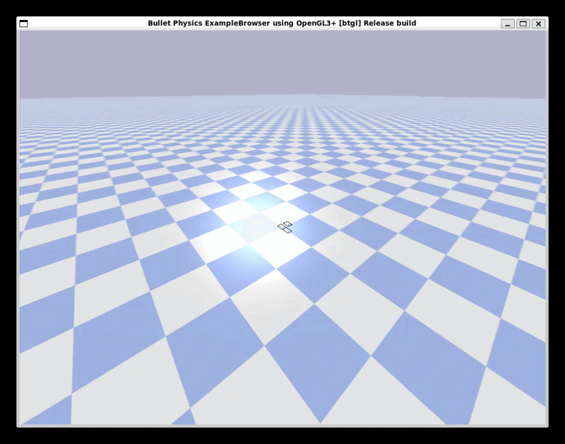
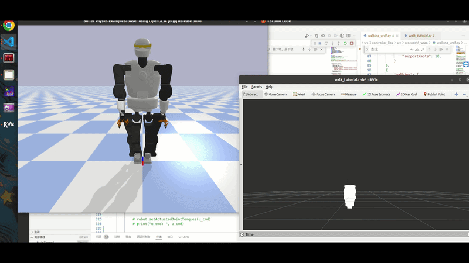

# TALOS Humanoid Robot Gait Control

This project implements a dynamic gait controller on the TALOS humanoid robot in PyBullet and Crocoddyl. 
Walking is controlled through a Center of Mass (CoM) floating base on the basis of the Linear Inverted Pendulum (LIP) model.
A video going through the final project presentation is available [here](https://youtu.be/QV4HBCid_CU).



## Gait Control

The system implements a multi-stage process using both TALOS' kinematic and dynamic model (whole body controller), the closed-loop LIP-MPC and an open-loop footstep-planner and Zero-Moment-Point (ZMP) -reference generator. Each controller operates at a distinct sampling frequency as noted on the top of the graphic. 


Walking and jumping motions are handled in an open-loop, offline manner using Crocoddyl. By receiving the next motion command and start state through PyBullet and the Robot's state machine, Crocoddyl calculates the future motion sequence, which in turn is then used within the gait controller. 


### Footstep Planner

The footstep planner works by using arcs of curvature k, defined as the inverse of the curvature radius r (k := 1/r), and the length of the trajectory l.  Footsteps are placed with equal distance to the curve on equally spaced distances of the arc. 


Trajectories are generated by chaining arcs and their respective footsteps together. In special cases, where the robot is supposed to turn without changing its position, the arc length is set to zero and rotation happens around the ground projection of the CoM.


### Gait Manager 

The gait manager is controlled by a finite state machine. As long as there is no command to stop walking, the machine will read the next step within a horizon of 3 footsteps from the footstep planner's generated trajectory. Upon finishing one footstep, the next footstep is loaded into the stack.


Here a demonstration of the gait manager over time: 




### MPC

The MPC is responsible for generating the CoM trajectory for the given horizon of steps as well as following said trajectory. The problem at hand is a finite horizon optimal control problem with constraints on its start and goal positions as well as linear bounds through the ZMP generated through the footsteps. The graphic below shows an example of a trajectory (blue line) with constraints by the foot steps (coloured rectangles). 


### Interpolator 

The interpolator uses a 5th degree polynomial to generate smooth trajectories for both position, velocity and acceleration of the CoM in the cartesian space. The trajectories are generated offline depending on the start and end states given by the Gait Manager module. The core of the interpolator uses the current elapsed time between two footsteps to return the next reference value. 


## Results


## NOTE: Curve Walking Behavior


Turning on a curve has been observed to sometimes result in the robot falling. Observations suggest that the error stems from an inaccuracy in the LIP model resulting in a buildup of error between the CoM and its reference. Other differences were observed when dealing with slight differences in dynamics between PyBullet and Crocoddyl. Analysis of the dynamics within both simulators suggest that this stems from a numerical processing difference between both engines. 


Here an example negative result. One noticeable problem is the handling of self-collisions within both simulators: 




## Analysis & Future Work 

Future work will focus on improvements of the LIP model to account for effects such as centripetal force. Furthermore, analysis on model behavior with uncertainties in foot friction contacts has to be analyzed in more detail. Designing a controller that can counteract said uncertainties is projected to also solve minor model inaccuracies. An adaptive controller is a valid candidate for this task. 


## Unit Test
```
catkin build --catkin-make-args run_tests
```

