# Legged_Robots_final_project

This project implements a dynamic gait controller on the TALOS humanoid robot in PyBullet and Crocoddyl. 
Walking is controlled through a CoM floating base on the basis of the Linear Inverted Pendelum (LIP) model.

<video controls src="media/Final_Walking_Behavior_Result.mp4" title="Title"></video>

## Gait Control

The system implements a multi-stage process using both TALOS' kinematic and dynamic model (whole body controller), the closed-loop LIP-MPC and an open-loop footstep-planner and ZMP-reference generator. Each controller operates at a distinct sampling frequency as noted on the top of the graphic. 

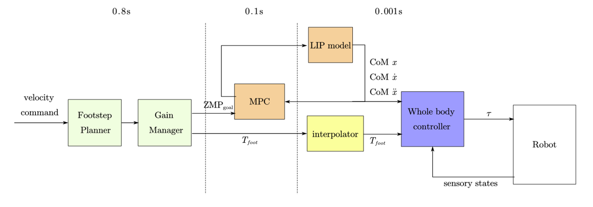


### Footstep Planner

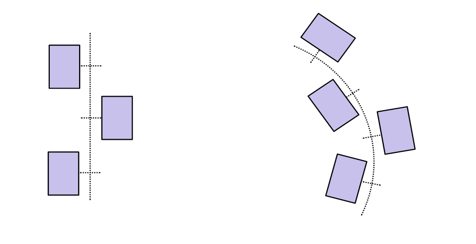

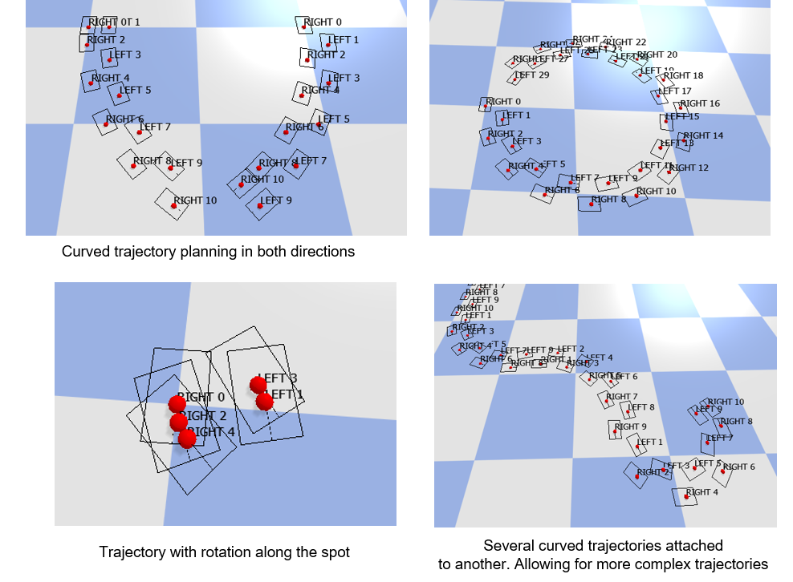

### Gait Manager 

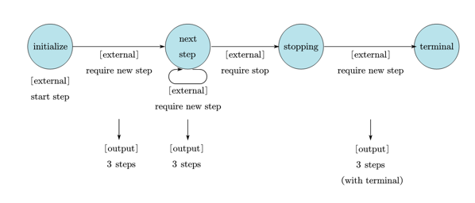

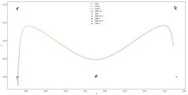

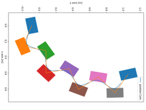

<video controls src="media/Footstep_Generator_over_time.mp4" title="Title"></video>

### MPC

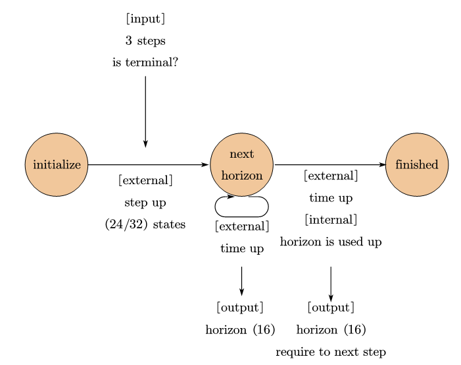

### Interpolator 

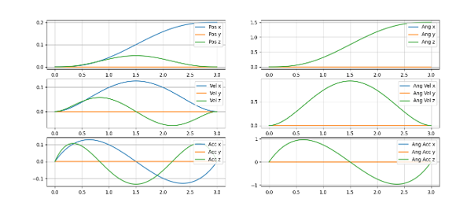


## Results

<video controls src="media/crocoddyl_performance_result_1.mp4" title="Title"></video>

<video controls src="media/crocoddyl_performance_result_2.mp4" title="Title"></video>


## NOTE: Curve Walking Behavior

<video controls src="media/Notealbe_Preformance_Differences_Crocoddyl_PyBullet.mp4" title="Title"></video>

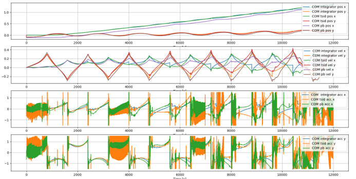


## Analysis & Future Work 

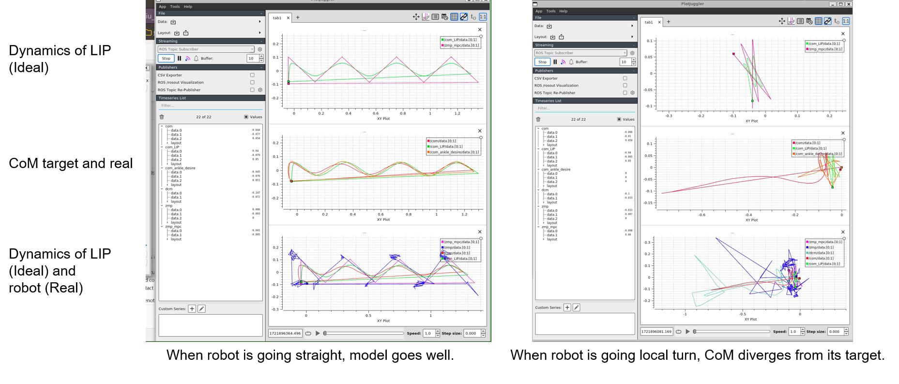

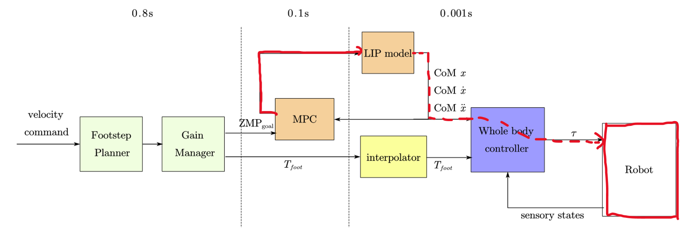


## Unit Test
```
catkin build --catkin-make-args run_tests
```

